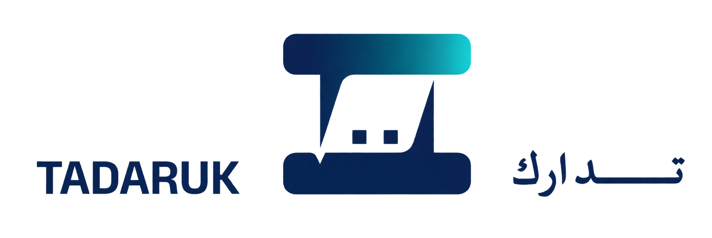

# TADARUK | تدارك

### Report. Track. Resolve.

**An intelligent maintenance management platform, from reporting an issue to confirming its resolution.**

TADARUK brings maintenance reports into one place. It uses AI-assisted analysis to turn written or spoken issue descriptions into structured tickets, route them to the appropriate technician, and track repairs through completion.

The platform connects three roles: **Reporters** submit and track issues, **Technicians** manage assigned tasks and document repairs, and **Operations Managers** oversee tickets, branches, and teams. Completed repairs also contribute to a shared knowledge base for future reference.
